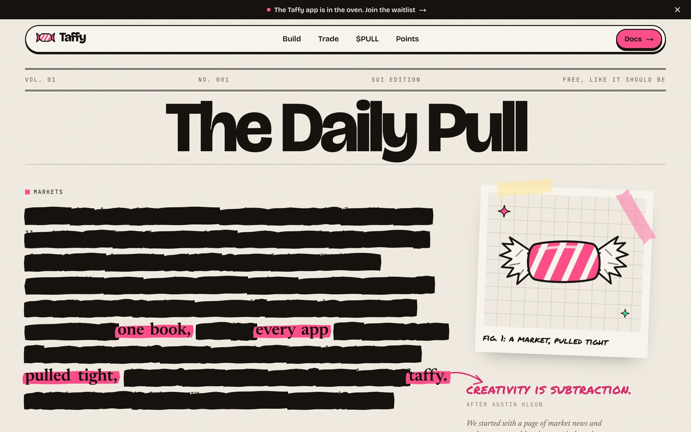

# Taffy

Marketing site for **Taffy**, a concept for a shared on-chain order book on Sui offering spot, margin and prediction markets.

[](https://nextjs.org)
[](https://react.dev)
[](https://www.typescriptlang.org)
[](https://tailwindcss.com)
[](LICENSE)



> **Note:** Taffy is a design concept. The partner teams, metrics, SDK and PULL token shown on the site are fictional.

## Overview

A fully static Next.js site with seven pages, built around an editorial paper-and-ink visual system. All illustrations are inline SVG components; the project ships no raster image assets.

| Route      | Page                                                            |
| ---------- | --------------------------------------------------------------- |
| `/`        | Home                                                            |
| `/build`   | Builder hub: primitives, composition example, recipes, resources |
| `/trade`   | Trader hub: simulated order book, onboarding, FAQ               |
| `/token`   | Token overview: utility, supply and allocation                  |
| `/points`  | Points program: balance lookup, leaderboard, FAQ                |
| `/privacy` | Privacy policy (sample text)                                    |
| `/terms`   | Terms of use (sample text)                                      |

## Features

- **Animated hero.** A newspaper column is progressively redacted until only the headline remains.
- **Spread interaction.** A draggable, physics-style ribbon visualises how fragmented liquidity widens spreads. It supports pointer, touch and keyboard input.
- **Pinned scroll sequence.** The three products are presented in a scroll-scrubbed, pinned section on desktop and fall back to a stacked layout on small screens.
- **Interactive components.** A simulated live order book, a points balance lookup with an activity heatmap, tabbed product details and accessible accordions.
- **Scroll-driven motion.** Reveals, stroke drawing, count-up figures and stamp effects are declared with `data-*` attributes and wired up in one place.
- **Accessibility.** Semantic landmarks, a skip link, labelled controls, keyboard support and full `prefers-reduced-motion` handling.
- **Performance.** Every route is statically prerendered and fonts are self-hosted through `next/font`, so the site makes no third-party requests.

## Tech stack

- [Next.js 16](https://nextjs.org) (App Router, Turbopack)
- [React 19](https://react.dev)
- [TypeScript](https://www.typescriptlang.org)
- [Tailwind CSS 4](https://tailwindcss.com)
- [GSAP](https://gsap.com) with ScrollTrigger
- [Lenis](https://lenis.darkroom.engineering) smooth scrolling
- [Playwright Core](https://playwright.dev) for visual verification

## Getting started

### Prerequisites

- Node.js 22 or later (see `.nvmrc`)
- Google Chrome, only for `npm run verify`

### Installation

```sh
git clone https://github.com/shaibuafeez/taffy.git
cd taffy
npm ci
npm run dev
```

The development server runs at [http://127.0.0.1:3007](http://127.0.0.1:3007).

### Scripts

| Command             | Description                                                               |
| ------------------- | ------------------------------------------------------------------------- |
| `npm run dev`       | Start the development server                                              |
| `npm run build`     | Create a production build                                                 |
| `npm start`         | Serve the production build                                                |
| `npm run typecheck` | Run the TypeScript compiler without emitting                              |
| `npm run verify`    | Capture desktop and mobile screenshots of every route and report console errors to `evidence/` |

## Project structure

```text
src/
├── app/
│   ├── layout.tsx            Root layout, fonts, metadata
│   ├── globals.css           Design tokens and component styles
│   ├── page.tsx              Home
│   ├── build/ trade/ token/ points/ privacy/ terms/
│   └── not-found.tsx
├── components/
│   ├── Art.tsx               SVG illustrations and logo
│   ├── Scribble.tsx          Annotation graphics
│   ├── Sections.tsx          Shared page sections
│   ├── Motion.tsx            Smooth scroll and scroll-driven animation
│   ├── BlackoutHero.tsx      Home hero
│   ├── TaffyPull.tsx         Spread interaction
│   ├── StackScroller.tsx     Pinned product sequence
│   ├── OrderBook.tsx         Simulated order book
│   ├── PointsLookup.tsx      Points balance lookup
│   └── ...
└── content.ts                All site copy and data
scripts/
└── verify.mjs                Visual verification script
```

## Customisation

- **Content.** All copy, figures, team listings and FAQs live in `src/content.ts`.
- **Theme.** Colours and font families are defined as tokens in the `@theme` block of `src/app/globals.css`.
- **Motion.** Add `data-reveal`, `data-draw`, `data-count`, `data-stamp`, `data-print` or `data-drift` to any element; `src/components/Motion.tsx` handles the rest.

## Credits

The visual direction draws on Austin Kleon's *Steal Like an Artist*, *Show Your Work!* and *Keep Going*. Typefaces are Bricolage Grotesque, Newsreader, Permanent Marker and JetBrains Mono, all licensed under the SIL Open Font License.

## License

Released under the [MIT License](LICENSE).
